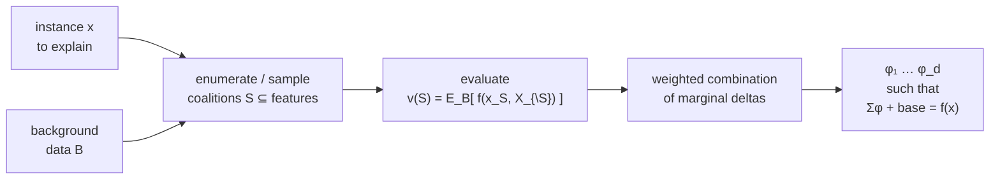
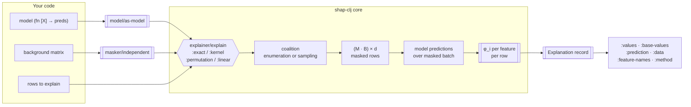
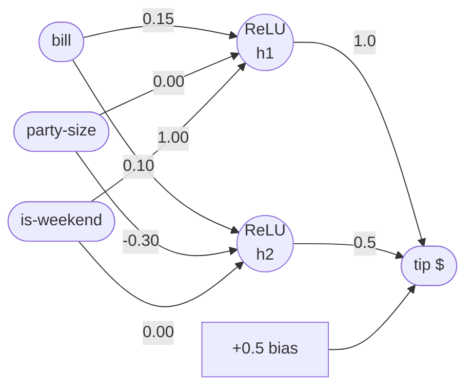
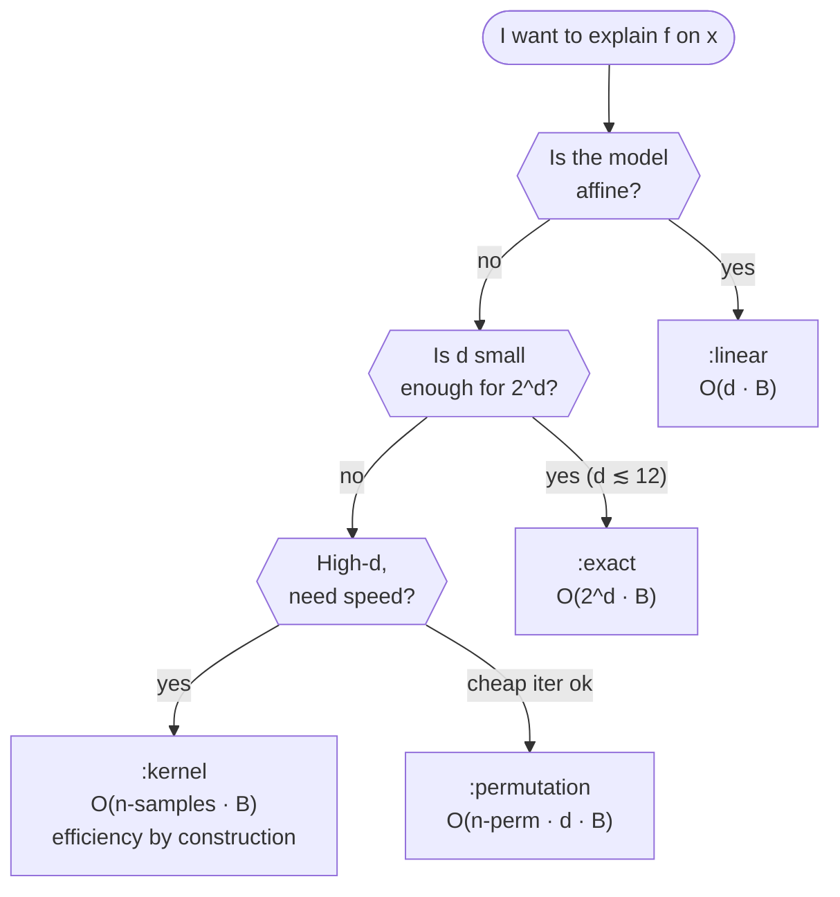

# shap-clj

> Model-agnostic Shapley-value feature attributions for any Clojure function
> that turns a matrix of inputs into a vector of predictions. Four
> interchangeable explainers, no native dependencies in the core, and a
> worked end-to-end example you can read in ten minutes.

```clojure
(require '[shap-clj.shap :as shap])

(shap/explain model X {:background bg :method :kernel :n-samples 4000})
;; => #Explanation{:values ... :base-values ... :prediction ... :method :kernel}
```

---

## Table of contents

- [What is SHAP?](#what-is-shap)
- [How shap-clj works](#how-shap-clj-works)
- [Setup](#setup)
- [Quick start](#quick-start)
- [The worked example — a tip predictor](#the-worked-example--a-tip-predictor)
  - [Why this model?](#why-this-model)
  - [Architecture](#architecture)
  - [Background distribution](#background-distribution)
  - [Predictions](#predictions)
  - [SHAP attributions across all four explainers](#shap-attributions-across-all-four-explainers)
  - [Waterfall — decomposing one prediction](#waterfall--decomposing-one-prediction)
  - [Global feature importance](#global-feature-importance)
  - [Per-order attribution bars](#per-order-attribution-bars)
  - [Plot outputs from `shap-clj.plot`](#plot-outputs-from-shap-cljplot)
- [Choosing an explainer](#choosing-an-explainer)
- [API reference](#api-reference)
- [Running tests and the demo](#running-tests-and-the-demo)
- [Project layout](#project-layout)

---

## What is SHAP?

SHAP (SHapley Additive exPlanations, Lundberg–Lee 2017) turns any prediction
into a linear breakdown over its input features:

> `prediction = base_value + φ₁ + φ₂ + ... + φ_d`

`φᵢ` is the share of the prediction attributable to feature *i*. The values
are derived from **Shapley values** in cooperative game theory — the unique
attribution scheme that satisfies four axioms simultaneously:

| Axiom         | What it guarantees |
|---------------|---------------------|
| **Efficiency** (local accuracy) | `Σφᵢ + base = f(x)` exactly |
| **Symmetry**  | Two features that enter the model identically get equal φ |
| **Dummy**     | A feature that never affects the output gets φ = 0 |
| **Linearity** | `φ(α·f + β·g) = α·φ(f) + β·φ(g)` |

The intuition: to attribute *x*'s prediction, we imagine every possible
ordering of revealing the features and average each feature's marginal
contribution across all orderings. Under an independent background
distribution, the "absence" of a feature is simulated by drawing its
value from the background.



The four explainers in this library differ only in **how they approximate
that weighted combination** — exact enumeration, constrained weighted
least-squares (KernelSHAP), Monte-Carlo permutation averaging, or a
closed-form shortcut for linear models.

---

## How shap-clj works



The pipeline has three moving parts:

1. **Model** — anything you pass to `shap/explain` is run through
   `model/as-model`. By default your function is assumed to take a
   2-D double array and return a 1-D numeric vector; `:row? true` wraps
   it as a row-at-a-time fn instead.
2. **Masker** — `masker/independent bg` turns `(x, coalition)` pairs into a
   batch of synthetic rows by keeping features in the coalition at `x`
   and replacing the rest with samples from the background. This is the
   **independent-features assumption**: absent features are marginalised
   over the background's marginal distribution.
3. **Explainer** — builds a list of coalitions (all of them for
   `:exact`; weighted Monte-Carlo for `:kernel`/`:permutation`; just the
   anchors plus finite differences for `:linear`), evaluates the model on
   the masker's output, and combines the results into a Shapley value
   per feature.

The output is always an `Explanation` record with the same shape
regardless of which explainer produced it.

---

## Setup

### Prerequisites

- **JDK 11+** (JDK 21 works)
- **Clojure CLI** (`brew install clojure/tools/clojure` on macOS, or see the [official install guide](https://clojure.org/guides/install_clojure))

### Add to your project

`deps.edn`:

```clojure
{:deps {io.github.arenainstitute/shap-clj {:git/sha "<latest-sha>"}}}
```

…or clone and use as a local dep while you're kicking the tyres:

```bash
git clone https://github.com/arenainstitute/shap-clj.git
cd shap-clj
clojure -M:example       # runs the tip-predictor demo
clojure -X:test          # runs the full test suite
```

### Optional aliases

| Alias           | Adds                                    | Unlocks                                        |
|-----------------|-----------------------------------------|------------------------------------------------|
| `:tablecloth`   | `scicloj/tablecloth`                    | Pass Tablecloth datasets directly to `explain` |
| `:dd`           | `uncomplicate/deep-diamond`             | `shap-clj.adapter.deep-diamond` wrapper        |
| `:neanderthal`  | `uncomplicate/neanderthal`              | Faster linear algebra (if you add the hook)    |
| `:all`          | all three                               | For running the adapter tests                  |

---

## Quick start

A two-feature model, explained from scratch:

```clojure
(require '[shap-clj.shap :as shap])

;; any (fn [X] predictions) — X is a 2-D double array (n × d)
(def model
  (fn [X]
    (let [out (double-array (alength ^"[[D" X))]
      (dotimes [i (alength out)]
        (let [r ^"[D" (aget ^"[[D" X i)]
          (aset out i (+ (* 2.0 (aget r 0)) (* -1.0 (aget r 1))))))
      out)))

(def bg [[0.0 0.0] [1.0 2.0] [-1.0 -1.0] [2.0 0.5]])

(def expl (shap/explain model [[1.5 0.5]]
                        {:background bg :method :exact
                         :feature-names ["a" "b"]}))

(mapv vec (:values expl))        ;; => [[3.25 -1.75]]
(vec (:base-values expl))        ;; => [-0.0]
(vec (:prediction expl))         ;; => [2.5]        ← model output
(vec (shap/efficiency-residuals expl))
;; => [0.0]                              ← Σφ + base = prediction ✓

(shap/feature-ranking expl)
;; => [{:feature "a" :mean-abs-value 3.25} {:feature "b" :mean-abs-value 1.75}]
```

---

## The worked example — a tip predictor

Running `clj -M:example` prints the demo below. The source is in
`examples/shap_clj/examples/tip_predictor.clj` and its end-to-end
validation in `test/shap_clj/examples/tip_predictor_test.clj`
(25 tests, 83 assertions).

### Why this model?

The tip predictor is deliberately the smallest model that still exercises
every interesting property of a SHAP implementation:

- **Small enough for the correctness oracle.** With `d = 3`, the
  `:exact` enumeration evaluates `2³ · 12 = 96` model calls per row —
  instant, and a ground truth the other methods are compared against.
- **Non-linear.** ReLU ensures the approximate methods have something
  non-trivial to converge to.
- **Linearisable.** Zero bias on the hidden layer means the network
  collapses to `w = W2·W1 = [0.20, −0.15, 1.00]` when both ReLUs are
  active. That gives us the closed-form `φᵢ = wᵢ·(xᵢ − μᵢ)` as a
  second, independent oracle for the linear head.
- **One input trips a ReLU.** Order 3 (`[8, 4, 0]`) clips `h2`, turning
  the demo into a live A/B comparison between exact attribution and the
  linear explainer's approximation.

### Architecture



Written out:

```
h1 = ReLU(0.15·bill + 0.00·party-size + 1.00·is-weekend)
h2 = ReLU(0.10·bill − 0.30·party-size + 0.00·is-weekend)
y  = 1.0·h1 + 0.5·h2 + 0.5
```

All weights are hand-chosen, so every prediction and every SHAP value
is deterministic and hand-verifiable.

### Background distribution

`tip/training-data` is twelve toy dinner checks used as the SHAP
background. The masker draws from this when it needs to simulate
"feature absent":

| # | bill | party | weekend |   | # | bill | party | weekend |
|---|----:|------:|--------:|---|---|----:|------:|--------:|
| 0 |  20 | 1 | 0 |   | 6 |  25 | 1 | 0 |
| 1 |  35 | 2 | 0 |   | 7 |  60 | 3 | 0 |
| 2 |  50 | 2 | 1 |   | 8 |  90 | 5 | 1 |
| 3 |  15 | 1 | 0 |   | 9 |  40 | 2 | 1 |
| 4 |  45 | 3 | 1 |   |10 |  30 | 2 | 0 |
| 5 |  75 | 4 | 1 |   |11 |  55 | 3 | 1 |

Column means: `μ = [45.00, 2.417, 0.500]`.

### Predictions

`tip/sample-orders` holds four inputs we explain end-to-end:

| Order | `[bill, party, weekend]` | h1  | h2        | Prediction |
|:-----:|:-------------------------|----:|----------:|-----------:|
| 0     | `[ 50, 2, 1]`            | 8.5 | 4.4       | **$11.20** |
| 1     | `[ 25, 1, 0]`            | 3.75| 2.2       | **$5.35**  |
| 2     | `[100, 5, 1]`            | 16.0| 8.5       | **$20.75** |
| 3     | `[  8, 4, 0]`            | 1.2 | **0** (clip!) | **$1.70** |

### SHAP attributions across all four explainers

Base value `E[f(X)]` over the background: **9.6375**.

On rows 0–2 both hidden units are active, the ReLU is effectively
linear on the path from input to output, and the network equals its
affine closure. All four explainers therefore produce **identical φ
values** on those rows. Row 3 is where the methods diverge:

| Row | Method                         | φ(bill) | φ(party-size) | φ(is-weekend) | `base + Σφ` | f(x) |
|-----|--------------------------------|--------:|-----:|--------:|-------:|-------:|
| **0** | all four                     | +1.0000  | +0.0625 | +0.5000 | 11.20 | 11.20 ✓ |
| **1** | all four                     | −4.0000  | +0.2125 | −0.5000 |  5.35 |  5.35 ✓ |
| **2** | all four                     | +11.0000 | −0.3875 | +0.5000 | 20.75 | 20.75 ✓ |
| **3** | exact / kernel / permutation | −7.2708  | −0.1667 | −0.5000 | **1.70** | 1.70 ✓ |
| **3** | linear                       | −7.4000  | −0.2375 | −0.5000 | **1.50** | 1.70 ✗ |

The linear explainer attributes as if the network were always affine,
so its `Σφ + base = 1.50` matches the *linear head's* output — not the
ReLU network's actual `1.70`. The 0.20 gap is the linearisation error.
This is expected, and it's why the test suite only asserts the linear
explainer's local accuracy on the linear-head variant of the model.

The efficiency residuals for the exact explainer confirm Σφ + base =
prediction to machine epsilon:

```clojure
(vec (shap/efficiency-residuals e))
;; => [1.78e-15 8.88e-16 0.0 -6.66e-16]
```

<details>
<summary>Full <code>clj -M:example</code> output (click to expand)</summary>

```
=== shap-clj example: tip predictor ===

Features      : [bill party-size is-weekend]
Background rows: 12

--- Predictions ---
Order 0  bill= 50.00 party=2 weekend=1  →  tip $11.20
Order 1  bill= 25.00 party=1 weekend=0  →  tip $5.35
Order 2  bill=100.00 party=5 weekend=1  →  tip $20.75
Order 3  bill=  8.00 party=4 weekend=0  →  tip $1.70

--- SHAP (exact) ---
base value (E[f(X)]): 9.6375
Order 0 (pred 11.20)
  bill       φ = +1.0000
  party-size φ = +0.0625
  is-weekend φ = +0.5000
Order 1 (pred 5.35)
  bill       φ = -4.0000
  party-size φ = +0.2125
  is-weekend φ = -0.5000
Order 2 (pred 20.75)
  bill       φ = +11.0000
  party-size φ = -0.3875
  is-weekend φ = +0.5000
Order 3 (pred 1.70)
  bill       φ = -7.2708
  party-size φ = -0.1667
  is-weekend φ = -0.5000

--- SHAP (kernel) ---
[identical to exact on all four rows]

--- SHAP (permutation) ---
[identical to exact on all four rows]

--- SHAP (linear) ---
[identical on rows 0-2; row 3 diverges]
Order 3 (pred 1.70)
  bill       φ = -7.4000
  party-size φ = -0.2375
  is-weekend φ = -0.5000
```

</details>

### Waterfall — decomposing one prediction

Order 3 (`bill = 8`, `party = 4`, `weekend = 0`) under the exact
explainer. Read top-to-bottom: start at the baseline, apply each
feature's φ, end at `f(x)`.

```
                                               tip ($)
                                    0    2    4    6    8    10   12
                                    │    │    │    │    │    │    │
  baseline       E[f(X)]  9.6375                                ●──┤
                                                                │
  bill         (x=8, μ=45) −7.2708  ●────────────────────────── ┤        small bill pulls tip down $7.27
                                                              │
  party-size   (x=4, μ=2.4) −0.1667                  ●─── ┤              large party shaves $0.17
                                                          │
  is-weekend   (x=0, μ=0.5) −0.5000                  ●──── ┤             weekday shaves $0.50
                                                                │
  prediction                1.7000   ●                            │
```

### Global feature importance

Mean |φ| across all four orders — which feature carries the most
attribution magnitude overall?

```
bill        5.818   █████████████████████████████
is-weekend  0.500   ██
party-size  0.207   █
```

Obtained directly with `shap/feature-ranking`:

```clojure
(shap/feature-ranking e)
;; => [{:feature "bill"       :mean-abs-value 5.8177}
;;     {:feature "is-weekend" :mean-abs-value 0.5000}
;;     {:feature "party-size" :mean-abs-value 0.2073}]
```

`bill` dominates by more than an order of magnitude, which makes sense:
it enters both hidden units and varies over [8, 100] across the sample
orders while the other two features span {0, 1} and {1, 5}.

### Per-order attribution bars

Visualising the φ values from each order as a horizontal bar around
zero (each `█` = $0.25):

```
                           (negative)           0           (positive)
Order 0  ($11.20)          │                    │
  bill         +1.00       │                    │████
  party-size   +0.06       │                    │
  is-weekend   +0.50       │                    │██

Order 1  ($5.35)
  bill         −4.00       │████████████████    │
  party-size   +0.21       │                    │█
  is-weekend   −0.50       │                  ██│

Order 2  ($20.75)
  bill        +11.00       │                    │████████████████████████████████████████████
  party-size   −0.39       │                   █│
  is-weekend   +0.50       │                    │██

Order 3  ($1.70)           ← ReLU clipped
  bill         −7.27       │█████████████████████████████      │
  party-size   −0.17       │                 █  │
  is-weekend   −0.50       │                  ██│
```

### Plot outputs from `shap-clj.plot`

`shap-clj.plot` returns plain Clojure data maps shaped for Plotly
(consumable by Clay, Hanami, or serialised as JSON to a notebook). The
library itself pulls in no plotting dependency — you render however you
like. Here's what the helpers produce for the tip-predictor
`Explanation`:

**`(plot/bar e)` — global importance**

```clojure
{:data [{:type "bar"
         :orientation "h"
         :x [5.8177 0.5000 0.2073]
         :y ["bill" "is-weekend" "party-size"]}]
 :layout {:title "SHAP — mean |value| per feature"
          :margin {:l 180}
          :yaxis {:autorange "reversed"}
          :xaxis {:title "mean(|SHAP value|)"}}}
```

**`(plot/waterfall e 3)` — per-row decomposition (row 3)**

```clojure
{:data [{:type "waterfall"
         :orientation "h"
         :x [-7.2708 -0.5 -0.1667]
         :y ["bill = 8.0" "is-weekend = 0.0" "party-size = 4.0"]
         :base 9.6375
         :measure ["relative" "relative" "relative"]}]
 :layout {:title "SHAP waterfall — row 3 (pred 1.7000)"
          :margin {:l 260}
          :yaxis {:autorange "reversed"}}}
```

**`(plot/force-like e 3)` — a single-row contribution summary**

```clojure
{:base-value    9.6375
 :prediction    1.70
 :sum-of-shap  -7.9375
 :contributions
  ({:feature "bill"       :value 8.0 :shap -7.2708}
   {:feature "is-weekend" :value 0.0 :shap -0.5000}
   {:feature "party-size" :value 4.0 :shap -0.1667})}
```

**`(plot/beeswarm e)` — one scatter trace per feature, x = SHAP value, colour = feature value**

```clojure
{:data
  [{:type "scatter" :mode "markers" :name "bill"
    :x [1.0 -4.0 11.0 -7.2708]
    :y [0.185 -0.072 -0.234 -0.134]
    :marker {:color [50.0 25.0 100.0 8.0] :colorscale "RdBu" :showscale false}}
   {:type "scatter" :mode "markers" :name "is-weekend"
    :x [0.5 -0.5 0.5 -0.5]
    :y [1.374 0.605 1.371 1.352]
    :marker {:color [1.0 0.0 1.0 0.0] :colorscale "RdBu" :showscale false}}
   {:type "scatter" :mode "markers" :name "party-size"
    :x [0.0625 0.2125 -0.3875 -0.1667]
    :y [2.358 2.350 1.918 1.878]
    :marker {:color [2.0 1.0 5.0 4.0] :colorscale "RdBu" :showscale false}}]
 :layout {:title "SHAP beeswarm"
          :margin {:l 180}
          :yaxis {:tickvals (0 1 2) :ticktext ["bill" "is-weekend" "party-size"]
                  :autorange "reversed"}
          :xaxis {:title "SHAP value"}
          :showlegend false}}
```

---

## Choosing an explainer



Costs side by side:

| Method         | Cost                        | Notes |
|----------------|-----------------------------|-------|
| `:exact`       | `O(2^d · B)`                | Correctness oracle for `d ≲ 12` |
| `:kernel`      | `O(n-samples · B)`          | General model-agnostic. KernelSHAP (Lundberg–Lee 2017). Efficiency enforced by construction — one variable substituted out via the constraint — so `Σφ + base = pred` at machine epsilon at any sample count |
| `:permutation` | `O(n-permutations · d · B)` | Cheap per iteration. Paired (antithetic) permutations. Converges slower than `:kernel` on high-d |
| `:linear`      | `O(d · B)`                  | Affine models only. `:coefs`/`:intercept` optional — otherwise inferred by finite differences on the background |

`B` = background rows, `d` = features.

---

## API reference

```clojure
(require '[shap-clj.shap :as shap])

;; Explain every row of X at once:
(shap/explain model X {:background bg :method :exact})
(shap/explain model X {:background bg :method :kernel :n-samples 4000 :seed 0})
(shap/explain model X {:background bg :method :permutation :n-permutations 200})
(shap/explain model X {:background bg :method :linear})

;; A reusable closure bound to (model, background):
(def kex (shap/kernel-explainer model bg {:n-samples 4000}))
(kex X)

;; Sample a smaller background from a larger dataset:
(def bg (shap/background full-training-matrix 50))

;; The single strongest correctness signal — Σφ + base = prediction iff this is ~0 per row:
(shap/efficiency-residuals explanation)

;; Aggregates:
(shap/mean-abs-values explanation)     ; mean |φ| per feature
(shap/feature-ranking explanation)     ; sorted [{:feature ... :mean-abs-value ...} ...]

;; Pick a single row out of a batched Explanation:
(shap/row explanation 2)
```

### The `Explanation` record

| Field            | Type              | Meaning                              |
|------------------|-------------------|--------------------------------------|
| `:values`        | `double[n][d]`    | SHAP values per sample, per feature  |
| `:base-values`   | `double[n]`       | `E[f(X)]` under the background       |
| `:data`          | `double[n][d]`    | The rows that were explained         |
| `:feature-names` | `vector<string>`  | Feature labels                       |
| `:prediction`    | `double[n]`       | Model output on each row             |
| `:method`        | `keyword`         | `:exact`, `:kernel`, …               |
| `:extra`         | `map`             | Method-specific metadata (seeds etc) |

### The plot helpers

`shap-clj.plot` returns Plotly-shaped Clojure maps — no rendering
dependency. Feed them to Clay, Hanami, or serialise to JSON.

| Fn                                | Returns                                |
|-----------------------------------|----------------------------------------|
| `(plot/bar expl)`                 | Plotly bar trace of mean |φ| per feature |
| `(plot/waterfall expl row-index)` | Plotly waterfall for one row           |
| `(plot/beeswarm expl)`            | Plotly scatter traces, one per feature |
| `(plot/force-like expl row-idx)`  | Plain summary map (force plot stand-in) |

---

## Running tests and the demo

```bash
clojure -X:test                                                   # full suite (74 tests / 217 assertions)
clojure -X:test :nses '[shap-clj.examples.tip-predictor-test]'    # just the end-to-end (25 / 83)
clojure -M:example                                                # the demo printed above
```

The tip-predictor test suite is organised by property:

1. **Model sanity** — predictions match the hand-computed values
2. **Efficiency** — `Σφ + base = pred` per explainer
3. **Cross-explainer agreement** — kernel/permutation converge to exact
4. **Closed-form validation** — `φ = w·(x − μ)` on the linear head
5. **Axioms** — dummy, symmetry, linearity on the real ReLU net
6. **Edge cases** — `d = 1`, constant model, mean-input, extreme
   (10⁶-scale) inputs, single-row background, batched ↔ per-row
7. **Bookkeeping** — reproducibility under fixed seeds, Explanation
   shape, plot helpers render

---

## Project layout

```
src/shap_clj/
  shap.clj           Public entry point (explain, background, *-explainer)
  model.clj          Model protocol + FnModel / RowFnModel wrappers
  masker.clj         IndependentMasker
  coerce.clj         2-D double-array ↔ seq-of-seqs / Tablecloth / 1-D row
  explanation.clj    The Explanation record + residuals, rankings
  shapley.clj        Kernel weights, coalition enumeration + weighted sampling
  linalg.clj         Tiny WLS solver used by KernelSHAP
  plot.clj           Plotly-shaped maps
  explainer/         {exact, kernel, permutation, linear}.clj
  adapter/           deep_diamond.clj  (optional, behind :dd alias)

examples/shap_clj/examples/tip_predictor.clj    the end-to-end demo
test/shap_clj/                                  unit + axiom + cross + integration
test/shap_clj/examples/                         end-to-end validation of the demo
```

See [`CLAUDE.md`](./CLAUDE.md) for the full namespace-by-namespace rundown
and library conventions (primitive arrays, seeded randomness, efficiency
as the lead correctness signal).
